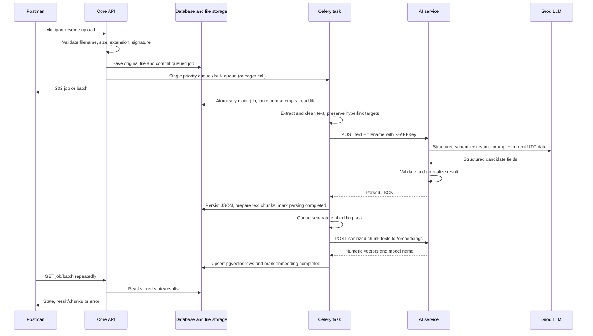

# Resume parsing: Postman and end-to-end testing

This collection follows the mounted routes and their implementations in this checkout. It contains all five parsing endpoints, the internal embedding endpoint, two AI diagnostic endpoints, and validation scenarios. No credentials are included. All fixture resumes are synthetic. See [embedding setup and verification](EMBEDDINGS.md) before running the updated flow.

## Import and run

1. Import `resume-parsing.postman_collection.json` and `resume-parsing.local.postman_environment.json` into Postman. Select the local environment.
2. Set `core_base_url` (default `http://localhost:8000`), `ai_base_url` (default `http://localhost:8001`) and `ai_service_api_key` locally. The key must match both services' configuration. `ai_api_prefix` defaults to `/api/v1`.
3. Set Postman's working directory to this `postman` directory, or reselect each fixture in Body > form-data. File references are local files, not embedded in the collection. Use the desktop app/agent with local file access. Keep the supplied files when running assertions that expect two valid files or one rejection.
4. Run `00 AI diagnostics` first. Health should return 200, then LLM connectivity and direct text parsing should return 200. The last two call the configured external model.
5. Run `01 Single resume flow`: upload returns 202 and captures `job_id`. The next GET reads the saved ID. For manual Send, resend GET until both parsing and embedding reach a terminal state. Success requires both `status` and `embedding_status` to be `completed`.
6. For automatic polling, set `auto_poll=true`, use Collection Runner, set request delay to **2000 ms**, and run the flow folder in order. `setNextRequest` does not loop a manual Send. The default limit is 240 polls; reaching it fails a test and stops the run. Increase the limit for a large batch. A pending response with manual polling is not an end-to-end success.
7. Run `02 Bulk resume flow`: submit two files, capture `batch_id` and `batch_job_id`, poll the batch, then inspect its first job. Success requires every accepted job to complete, not just HTTP 200/202.
8. Run the negative folder separately. Expected HTTP errors are passing tests. The mixed-validity case creates a real accepted job; its response contains the batch ID for optional manual polling.

Do not add environment variables named `job_id`, `batch_id`, or `batch_job_id`: they would override the IDs captured at collection scope. Do not manually set multipart Content-Type; Postman supplies its boundary. Repeated runs create new files/jobs/records; there is no cleanup or deduplication endpoint.

## Services and configuration

Run dependency installation and migrations in your normal development setup before testing. Use a test database. From `services/core-api`, run `python -m alembic upgrade head` and `python -m uvicorn app.main:app --reload --port 8000`. From `services/ai-service`, run `python -m uvicorn app.main:app --reload --port 8001`. Activate an environment containing each service's requirements first.

Core settings use the `APP_` prefix:

- `APP_DATABASE_URL`: PostgreSQL connection with the resume migrations applied.
- `APP_AI_SERVICE_URL`: AI service URL; default `http://localhost:8001`.
- `APP_AI_SERVICE_API_KEY`: shared service key.
- `APP_AI_SERVICE_TIMEOUT_SECONDS`: default 90 seconds per AI call.
- `APP_CELERY_TASK_ALWAYS_EAGER`: explicitly set `false` to test real queues.
- `APP_REDIS_URL`, or `APP_CELERY_BROKER_URL` / `APP_CELERY_RESULT_BACKEND`: queue infrastructure.
- `APP_RESUME_STORAGE_DIR`: shared file location accessible to API and worker.

AI settings have no APP prefix: configure `AI_SERVICE_API_KEY`, `GROQ_API_KEY`, and optionally `GROQ_MODEL`. `DEBUG` must be a boolean such as `false`; an inherited value such as `release` prevents startup. Restart services/workers after configuration changes because settings are cached.

For queued mode, start Redis and run this in `services/core-api` (Windows-friendly worker):

```powershell
python -m celery -A app.workers.celery_app:celery_app worker --loglevel=INFO -Q resume_priority,resume_bulk,resume_embeddings --pool=solo
```

Development/test defaults to eager execution unless explicitly overridden. In eager mode tasks run within the upload request, so 202 can already contain `completed` or `failed`, and retries do not reproduce normal broker scheduling. Allow a sufficiently long Postman request timeout, especially for eager bulk uploads. In queued mode workers must consume all three queues. Separate priority workers can provide stronger isolation; queue names alone do not guarantee a single upload preempts work already running.

## Endpoint inventory

- **POST Core `/api/v1/resumes/parse`**: multipart `file` required; text `candidate_id` optional, 1–255 characters. Returns 202 with a job. Core routes currently have no authentication dependency. `candidate_id` is stored metadata, not an applicant lookup/create operation.
- **POST Core `/api/v1/resumes/parse/bulk`**: multipart repeated `files` required. Returns 202 with a batch, jobs and `rejected`. There is no supported bulk candidate mapping parameter.
- **GET Core `/api/v1/resumes/jobs/{job_id}`**: UUID; 200 with state/result, 404 unknown ID, 422 invalid UUID.
- **GET Core `/api/v1/resumes/batches/{batch_id}`**: UUID; 200 with counts/jobs, 404 unknown ID, 422 invalid UUID. Unlike the upload response, this response does not include `rejected`.
- **POST AI `/api/v1/parse-resume`**: JSON `text` required, nonblank, 1–200,000 characters; optional `filename` up to 255 characters. Header `X-API-Key` required. Returns 200 structured data synchronously. Filename is accepted but not used by the parser. This does not create a Core job or persist results there.
- **GET AI `/api/v1/health`**: requires the key; 200 `{"status":"ok"}` only verifies the HTTP service/key, not LLM/database/worker health.
- **POST AI `/api/v1/llm-test`**: requires the key; JSON `message` nonblank, up to 4,000 characters. Returns 200 `{"response":"..."}` or 502 on LLM failure. This is a diagnostic, not resume parsing.

- **POST AI `/api/v1/embeddings`**: authenticated JSON `texts` array; returns model, dimensions and numeric vectors. Core's separate background task persists those vectors. See `EMBEDDINGS.md` for limits and verification.

The AI route prefix is configurable. Core's prefix is `/api/v1`. There is no mounted Core health endpoint, resume list/download/delete/retry endpoint, matching endpoint, or automatic applicant-creation endpoint in this flow. OpenAPI is available at `/openapi.json` when Core docs are enabled and on AI for contract inspection.

## What happens internally



The diagram shows queued mode; eager execution finishes task execution before the upload response.

1. Validation accepts PDF, DOCX and TXT. Defaults: 10 MiB/file, 50 files/batch, 50 PDF pages, 100,000 extracted characters. Settings can override them. PDF/DOCX signatures are lightweight checks; a corrupt file can pass upload validation and fail later during extraction. SHA-256 is recorded but does not prevent duplicate uploads.
2. Files are stored under year/month/UUID.extension; user filenames remain metadata. Core commits jobs before enqueueing. Single upload also creates a resume record immediately; bulk creates records when jobs complete.
3. The worker atomically claims only queued jobs, increments `attempts`, and marks `processing`. Extraction uses pypdf for PDFs, python-docx paragraphs/tables for DOCX, UTF-8 then Latin-1 for TXT. PDF/DOCX external HTTP links are preserved. Whitespace/control characters are cleaned and long text is truncated to the configured limit. DOCX expansion is limited to 50 MiB.
4. Core sends extracted text to AI. The active AI path is `api/v1/parse_resume.py` -> `parsing/service.py` -> structured LLM extraction -> `parsing/validators.py`. Other extractor/normalizer modules in the AI directory are not invoked by this route. There is no OCR fallback in the Core upload pipeline; image-only PDFs normally fail with no extractable text.
5. The result contains `personal_info`, `summary`, `skills`, `total_experience_years`, `experience`, `education`, `projects`, and `certifications`. Skills are whitespace-normalized and deduplicated case-insensitively. Present/current end dates become null with `is_current=true`. Experience duration merges overlapping periods; internships are excluded unless no usable regular-role periods exist. No usable dates leaves the model's original total unchanged.
6. Completion saves JSON on the job and in `resume_records`, plus deterministic text chunks for summary, skills, experience, projects, education and certifications. `vector_chunks` are source text/metadata, not numeric vectors. The separate embedding task sanitizes/splits those chunks and stores numeric vectors in `resume_chunk_embeddings`. No separate applicant record is created.

## States and failure tests

Jobs normally follow `queued -> processing -> completed`. Extraction/storage failures become `failed`. AI timeouts, transport errors, HTTP 429 and 5xx are retryable: `processing -> queued -> processing`. Default 3 retries means up to 4 attempts, with scheduled delays of 10, 20 and 40 seconds in queued mode. Other AI 4xx, absent client key, invalid JSON or a non-object payload fail without retry. A completed job should have parsed data, cleared error, and completion time; inspect the parsed values against the source resume manually because LLM output can vary.

Batch state is `processing` while any accepted job is queued/processing, `completed` when all succeed, `completed_with_errors` when terminal results are mixed, or `failed` when all accepted jobs fail. `total = queued + processing + completed + failed`. Validation rejects are excluded from total. A batch with one valid upload and one rejected file can therefore finish as `completed`.

Included negative cases: unsupported extension 415, fake PDF signature 415, empty file 400, missing upload 422, malformed job UUID 422, unknown job/batch 404, all-invalid bulk 400, partial-valid bulk 202, missing AI key 401, blank/missing AI text 422. AI must have its server key configured for the 401 case; absent server configuration returns 503 before validation.

Additional manual scenarios:

- Upload a file larger than the configured limit, or more than the batch file limit: expect 413. An individually oversized file in an otherwise valid batch is listed in `rejected`; if none are accepted, expect 400.
- Upload a real scanned/password-protected/too-many-pages PDF: upload can return 202, then polling reports `failed` with extraction details. Select your own genuine PDF/DOCX to test those extractors end to end; the bundled `invalid.pdf` is intentionally invalid.
- In queued mode, stop the worker: jobs remain queued. Restart it consuming all three queues to continue.
- In an isolated test setup, stop AI or use an unreachable AI URL: jobs retry then fail; inspect attempts/error_message. Restore settings and submit a new job; no public retry endpoint exists.
- Broker enqueue failure makes single upload return 503 after a failed job has been persisted. Bulk still returns 202 and exposes failed jobs in its counts; check the payload, not only HTTP status.
- Direct AI: missing model configuration can return 503; provider/structured extraction failure returns 502. Core treats both as retryable 5xx.

## Source map and verification

Core sources: `app/modules/resumes/router.py` (routes), `service.py` (validation/storage/enqueue), `tasks.py` and `processing.py` (execution/retries), `extraction.py` (file text), `repository.py` and `models.py` (state/persistence), `chunking.py` (text chunks), `schemas.py` (responses), `app/integrations/ai_client/client.py` (AI transport).

AI sources: `app/main.py` (mounting/key middleware), `app/api/v1/parse_resume.py`, `app/parsing/service.py`, `schemas.py`, `validators.py`, and `app/llm/client.py`.

Collection regeneration: from the repository root run `python postman/build_collection.py`. This overwrites the generated collection, environment and fixtures with their credential-free defaults.

The accompanying unit checks use mocked AI/in-memory storage; they do not establish live Redis, PostgreSQL, model credentials, or Postman execution. Live end-to-end testing requires running the steps above against your services.
